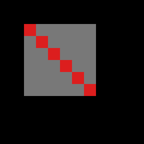
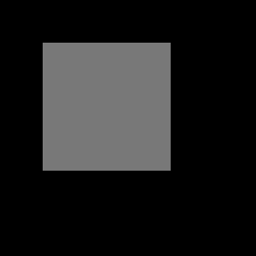
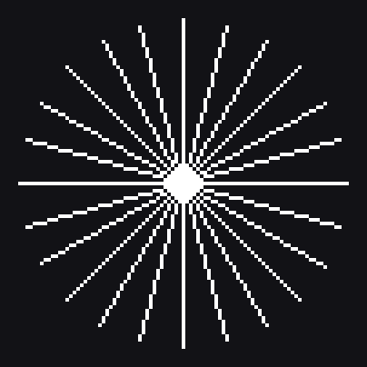
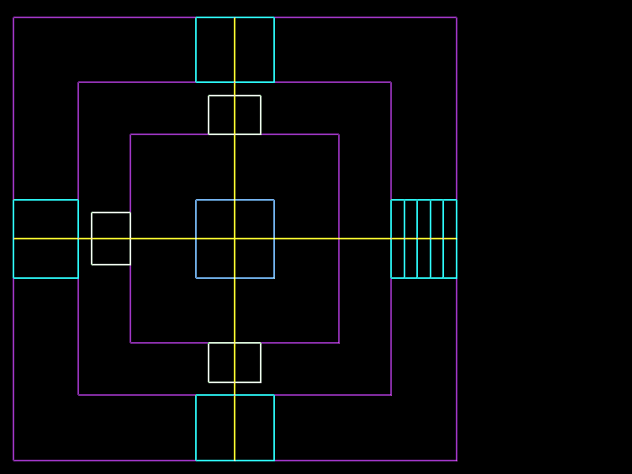
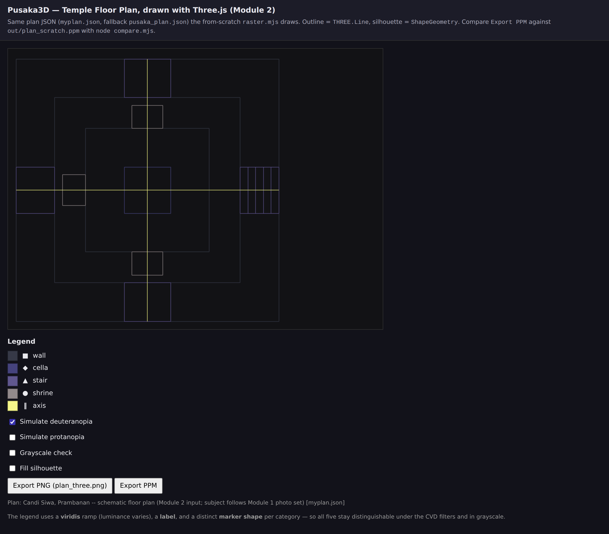
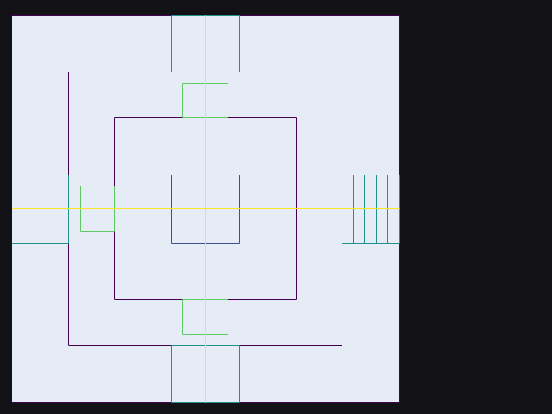

# Laporan Praktikum Modul 2 -- Rendering Pipeline & Primitif 2D

Mata kuliah Grafika Komputer · S1 Informatika UM Surabaya · Subjek: denah Candi Siwa, kompleks Prambanan (subjek yang sama dengan 15 foto Modul 1)
Repo: kode + tes + bukti ada di folder ini; semua angka di bawah berasal dari perintah yang tercatat dan bisa dijalankan ulang.

> **Catatan jujur sebelum membaca.**
> 1. Input denah adalah **`myplan.json`**: denah skematis **Candi Siwa (Prambanan)**, subjek yang sama dengan foto Modul 1. Ukuran alas 34 m persegi adalah angka yang dipublikasikan; offset platform dalam, lebar tangga, dan ukuran bilik adalah **perkiraan proporsional, bukan hasil survei**. Itu dinyatakan juga di kolom `note` pada JSON-nya. `pusaka_plan.json` tetap disimpan hanya sebagai cadangan.
> 2. Toolchain di bawah dicatat dari mesin tempat bukti dibuat (container Linux). Ganti dengan mesin Anda sendiri sebelum dikumpulkan.
> 3. URL GitHub Pages: https://yasminsyamlan.github.io/modul2-grafika-komputer/

## 0. Toolchain (Lab 1.1)

| Item | Nilai |
|---|---|
| OS | Microsoft Windows 11 Pro |
| Node | v24.14.1 |
| Browser | Chrome 156.0.8078.48 |
| Three.js | 0.160.0 |
| Tanggal | 2026-10-29 |
---

## A1. Input & penempatan di pipeline (Lab 1)

**Input.** `myplan.json` (Candi Siwa): 17 polyline / 50 segmen: dinding luar (`outer_wall`, 34×34 m), platform dalam (`inner_platform`), badan candi (`temple_body`), `cella`, tangga masuk timur (`entrance_stair` + 4 tread) dan tiga tangga lain (utara, selatan, barat), tiga bilik (`shrine_durga_north`, `shrine_agastya_south`, `shrine_ganesha_west`), dan dua sumbu (`axis_ns`, `axis_ew`). Satuan meter, x = timur, y = utara (y ke atas), `scale_px_per_m = 16.5`, `origin_m = [1,1]`. Memenuhi minimum Lab 1: dinding luar, pembagian interior (`inner_platform`, `temple_body`, `cella`), pintu masuk (`entrance_stair`). Divalidasi otomatis oleh `tests.mjs` (skema + minimum isi).

**Walk-through satu segmen dinding**: sisi bawah `outer_wall`, (0,0) m → (34,0) m, 7 tahap pipeline:

| # | Tahap | Yang terjadi pada segmen ini | Fixed / programmable |
|---|---|---|---|
| 1 | Application | JSON dimuat (`loadPlan`): dua titik `[0,0]`,`[34,0]`, kategori `wall`, polyline tertutup | kode kita |
| 2 | Vertex processing | `worldToScreen`: x=(0+1)·16,5=16,5→**17**, x=(34+1)·16,5=577,5→**578** (pembulatan `Math.round`); y=H−1−(0+1)·16,5=599−16,5=582,5→**583** (satu-satunya tempat flip sumbu-y). Hasil: (17,583)→(578,583) | programmable (vertex shader) |
| 3 | Assembly & clipping | Dua vertex dirakit jadi satu garis; seluruhnya di dalam 800×600 sehingga tidak ada yang dipotong. (Di kode kita clipping dilakukan per-pixel oleh `fb.set`, bukan sebelum rasterisasi.) | fixed |
| 4 | Rasterisation | `lineBresenham`: garis horizontal → 578−17+1 = **562 pixel** pada baris y=583 | fixed (di sini: `raster.mjs`) |
| 5 | Fragment shading | Warna datar kategori `wall` = viridis (68,1,84) | programmable (fragment shader) |
| 6 | Per-fragment ops | Tanpa depth/blend: pixel ditimpa sesuai urutan gambar (siluet dulu, garis kemudian) | fixed |
| 7 | Framebuffer | `Uint8ClampedArray` 800×600×3 → `out/plan_scratch.ppm` | -- |

**Uji "tahap dilewati" (A1, butir 2).** Jika tahap 2 dilewati (tanpa `worldToScreen`), koordinat meter 0..34 dipakai langsung sebagai pixel: seluruh candi mengecil menjadi titik ±34×34 px di pojok kiri-atas, dan tanpa flip-y ia terbalik (utara di bawah). Tes `plan -- worldToScreen flips y once` menjaga ini.

**Forward vs backward di atas kertas (Lab 1.4).** Ditulis sebelum menjalankan benchmark, lihat `PREDICTION.md`: forward menang di kedua zoom; rasio bwd/fwd ≈200-600× di 1×, mengecil di 10× karena forward tumbuh. Hasil ukur ada di A4.

**Bacaan (Lab 1.5): `Line.js` Three.js r160** (`node_modules/three/src/objects/Line.js`). Berkas ini **tidak merasterisasi apa pun**: ia hanya menyimpan geometri + material, punya `computeLineDistances()` (untuk garis putus-putus) dan `raycast()` (picking). Rasterisasi diserahkan ke GPU lewat `gl.drawArrays` (`WebGLBufferRenderer.js`). Bedanya dengan `raster.mjs`: kita menjalankan Bresenham di CPU, per pixel, tanpa anti-alias; GPU memakai aturan *diamond-exit* untuk garis + MSAA, jadi ujung/sudut garis berbeda sedikit (lihat A4).

**Refleksi kasus (Lab 1.6, ≈ setengah halaman).**
(a) Sumber: Microsoft Learn, *Directly Mapping Texels to Pixels (Direct3D 9)* (ms.date 2018-05-31, diperbarui 2021-01-06, diakses 2026-10-29) dan GameDev.net, *Understanding Half-Pixel and Half-Texel Offsets* (tanpa tanggal terbit pada halaman). Di **D3D9**, pusat pixel berada pada koordinat **integer** (0,0 = pusat pixel kiri-atas; pojok layar di (−0.5,−0.5)); untuk blit 2D yang diberi vertex pra-transform harus **dikurangi 0.5** pada x dan y. Di **D3D10+** dan OpenGL pusat pixel ada di **(x+½, y+½)** sehingga offset itu tidak diperlukan, persis konvensi modul ini.
(b) Baris yang mengodekan konvensi pusat: `raster.mjs` baris 192 `const px = x + 0.5, py = y + 0.5; // SAMPLE CENTRE` (dan `coverage()` memakai pusat yang sama).
(c) Citra uji yang membuat bug jelas: grid/checkerboard **1 pixel** yang di-blit 1:1 dengan bilinear. Tanpa offset setiap pixel membaca titik temu empat texel, sehingga hasilnya abu-abu blur (contoh Microsoft: pixel yang seharusnya merah menjadi "¾ abu-abu + ¼ merah"). `node sample_centre.mjs` menunjukkan versi hitungnya: 4 texel berbobot ¼ vs 1 texel berbobot 1.
(d) Perubahan di Studi Kasus yang akan menangkapnya: langkah **bandingkan** `compare.mjs`. Saya sengaja menjalankan viewer dengan `?half=0` (vertex garis di sudut pixel, bukan pusat): identik 464 261/480 000 dan **PSNR turun ke 29,1 dB**, versus 479 952/480 000 dan **58,5 dB** dengan offset 0,5. Selisih ~29 dB itulah bug setengah-pixel yang terukur.

---

## A2. Primitif from-scratch dicocokkan dengan referensi (Lab 2.1, 2.3)

**Satu unit output dihitung manual** (`triangle()`, A(1,1) B(6,2) C(3,7), total 2·luas = 28 > 0, winding benar). Pusat pixel = (x+.5, y+.5). Aturan: inside iff E>0, atau E=0 pada edge yang dimiliki.

| Pixel | pusat | E_AB | E_BC | E_CA | hasil | cocok kode |
|---|---|---|---|---|---|---|
| (2,3) | (2.5,3.5) | 11 | 13 | 4 | **di dalam** (semua >0) | ya |
| (0,0) | (0.5,0.5) | −2 | 32 | −2 | **di luar** | ya |
| (3,1) | (3.5,1.5) | **0** | 14 | 14 | **on-edge** AB: dimiliki edge AB (A→B: Δ=(5,1), Δy>0) → dinyalakan oleh aturan modul (tidak oleh d3d) | ya |
| (1,2) | (1.5,2.5) | 7 | 21 | **0** | **on-edge** CA: C→A: Δ=(−2,−6), Δy<0 → tidak dimiliki aturan modul, dimiliki d3d | ya |

Contoh: E_AB(3.5,1.5) = (6−1)(1.5−1) − (2−1)(3.5−1) = 2.5 − 2.5 = 0. Barycentric (3.5,3.5): (λA,λB,λC) = (8/28, 10/28, 10/28) = (0.286, 0.357, 0.357), jumlah 1 (Contoh E5: 10/20/40 pada (.5,.25,.25) → 20, lulus di `tests.mjs`).

**Daftar 8 pixel (2,1)→(9,5).** `lineDDA` dan `lineBresenham` keduanya memberi `(2,1),(3,2),(4,2),(5,3),(6,3),(7,4),(8,4),(9,5)` (tes E2/E3). Hitungan tangan variabel keputusan modul: D₀=2·4−7=1, lalu D = 1,−5,3,−3,5,−1,7 (tabel E3, murni integer); kode memakai bentuk error Zingl yang ekuivalen dan juga hanya add/compare, sehingga menangani 8 oktan. Tambahan: 5000 segmen acak → ujung tepat, panjang = max(|Δx|,|Δy|)+1, 8-connected.

**Raster segitiga vs referensi.** `ref/tri_ref.ppm` (8×9) dibuat oleh **program Python independen** (`ref/make_tri_ref.py`, aritmetika rasional eksak, formulasi lain: titik uji digeser p±(ε,ε²) → tanpa kasus "top/left" dan tanpa konstanta bias). `triangle()` cocok **byte demi byte** (max |diff| = 0) untuk kedua aturan (`tri_ref.ppm`, `tri_ref_d3d.ppm`). Contoh terpadu: `compare.mjs out/square_fill.ppm ref/square_fill_ref.ppm` → `identical 144/144, PSNR inf, SSIM 1.000, max|diff| 0`. Tambahan: 3000 segitiga acak × 2 aturan × 256 pixel cocok dengan oracle yang sama (>1,5 juta perbandingan).

**Sample-centre (Lab 2.3).** `node sample_centre.mjs`: rectangle 2×2 di (1,1) dengan aturan pusat menyalakan tepat (1,1),(2,1),(1,2),(2,2) = 4 pixel; aturan sudut/interval tertutup menyalakan 3×3 = 9 (satu baris + satu kolom kelebihan, tergeser ke kiri-atas, Contoh E1b).

**Octant (Lab 2.5).** `node octant_test.mjs`: asterisk 24 jari-jari tiap 15°, R=45: panjang Euclid tiap jari-jari 44,64–45,28 (selisih terbesar **0,36 px** dari R; syaratnya ≤1) dan jumlah pixel simetris pada pencerminan; DDA = Bresenham pada semua ujung. Citra: `report/asterisk.png`.

---

## A3. Diagnosis dan perbaikan, dengan bukti (Lab 2.2)

**Diagnosis dari pixel yang dirender saja** (`node triangle_gap_bug.mjs`): gambar tiap segitiga ke layer sendiri tanpa aturan top-left, lalu lihat pixel yang menyala di kedua layer.
- T1 21 px, T2 21 px, gabungan 36 px → **6 pixel tergambar dua kali**: (2,2) (3,3) (4,4) (5,5) (6,6) (7,7), semuanya x = y.
- Penyebab: pusat pixel-pixel itu persis di edge bersama y=x; edge function = 0 di **kedua** segitiga, dan "E ≥ 0" mengklaim keduanya (double-blend/stencil). Kebalikannya, "E > 0" membuat keenamnya **celah** (gaps=6).

| Mode | once | twice | gaps |
|---|---|---|---|
| ≥ 0, tanpa aturan | 30 | **6** | 0 |
| > 0, tanpa aturan | 30 | 0 | **6** |
| aturan top-left (modul) | **36** | **0** | **0** |
| aturan top-left (d3d) | 36 | 0 | 0 |

Citra coverage: `report/gap_coverage_buggy.png` (merah = ganda), `report/gap_coverage_cracks.png`, `report/gap_coverage_fixed.png`.

**Edge mana dapat bias 0 / −1** (aturan modul, y-bawah, total>0): T1=(2,2),(8,2),(8,8): (2,2)→(8,2) **−1**; (8,2)→(8,8) **0**; (8,8)→(2,2) **−1**. T2=(2,2),(8,8),(2,8): (2,2)→(8,8) **0**; (8,8)→(2,8) **0**; (2,8)→(2,2) **−1**. Edge diagonal dimiliki T2 (bias 0) dan tidak oleh T1 (−1) → enam pixel diagonal jatuh ke T2 tepat sekali.

### Dua temuan tambahan pada kode/teks starter (sudah diperbaiki)

**Temuan 1: bias integer −1 membuang pixel yang valid.** Listing modul menulis `E + bias >= 0` dengan bias 0/−1. Pusat pixel di x+½, sehingga E berupa **setengah-integer** bila (Δx−Δy) ganjil; mis. E=0.5 dengan bias −1 menjadi −0.5 dan pixel yang *benar-benar di dalam* ikut ditolak. Bukti: persegi panjang 7×4 dipecah pada diagonal 7:4 → pixel **(5,3)** (strictly inside) hilang → celah nyata; 2000 dari 2659 quad acak punya pixel interior yang hilang di kode awal. Perbaikan di `raster.mjs`: tie-break eksak, "E > 0 selalu lolos; E == 0 lolos hanya bila edge dimiliki", setara dengan bias ε→0 dan tetap hanya memakai bilangan eksak. Setelah itu: 0 kegagalan pada 1500 quad acak × 2 aturan (tes `watertight`).

**Temuan 2: aturan di listing sebenarnya "bottom-right", bukan "top-left".** Dengan konvensi modul sendiri (y ke bawah, total>0 = searah jarum jam di layar), edge **atas** berjalan ke kanan (Δy=0, Δx>0) dan edge **kiri** berjalan ke atas (Δy<0). Listing memiliki Δy=0 & Δx<0 dan Δy>0, yaitu edge **bawah/kanan**. Keduanya tetap *watertight* (edge bersama dilewati dua segitiga dalam arah berlawanan, jadi tepat satu yang memiliki), hanya beda *siapa* yang mendapat pixel on-edge; itu sebabnya semua tes modul lulus. Saya mempertahankan aturan modul sebagai **default** (`rule:"module"`) karena `ref/square_fill_ref.ppm` dari dosen dibuat dengannya, dan menambah `rule:"d3d"` (top-left sungguhan, seperti GPU). Keduanya diverifikasi oleh oracle Python independen. Pada viva, kalimat ringkasnya: *"hasil watertight tidak bergantung pada pilihan kepemilikan, asalkan konsisten; yang berubah hanya pemilik pixel on-edge."*

---

## A4. Pustaka vs from-scratch, dan keputusannya (Lab 3)

**Render pustaka.** `web/` (Three.js 0.160.0): outline = `THREE.Line`, siluet = `ShapeGeometry`, ukuran tetap 800×600, `setPixelRatio(1)` + `setSize(800,600,false)` (diuji pada layar DPR=2; canvas tetap 800×600). Diekspor ke `plan_three.png`.

**Tabel `compare.mjs`** (scratch = `draw_plan.mjs`, 800×600, 50 segmen, `myplan.json`):

| Perbandingan | identik | PSNR | SSIM | max\|diff\| |
|---|---|---|---|---|
| fill + outline, garis di pusat pixel (+0,5) | 479 952 / 480 000 (99,990%) | **56,7 dB** | 1,000 | 110 |
| outline saja, (+0,5) | 479 952 / 480 000 | 58,5 dB | 1,000 | 110 |
| outline saja, **half=0** (bug setengah-pixel) | 464 261 / 480 000 (96,7%) | **29,1 dB** | 0,738 | 227 |

Citra selisih: `report/diff_plan_fill.png` (×6), `report/diff_plan_half0.png`.

**Penjelasan setiap pixel yang tidak cocok (48 pixel, `tools/diff_pixels.mjs`).** Seluruhnya adalah **ujung atau sudut garis**: 4 sudut persegi dinding luar (68,1,84 → 56,6,69 atau 109,60,125), titik ujung sumbu kuning (253,231,37 → 143,188,89), sudut bilik/shrine (94,201,98 → 128,210,135 atau 88,151,95), serta sudut cella dan tangga (mis. 59,82,139 → 102,121,166). Tidak ada satu pun pixel di interior siluet atau di tengah garis yang berbeda. GPU menerapkan aturan *diamond-exit* pada garis dan MSAA (`antialias:true`): pixel ujung hanya ditutupi sebagian, sehingga berwarna campuran dengan latar; Bresenham menyalakan pixel ujung penuh. Interior (siluet terisi) **identik**, karena kedua rasteriser memakai pusat pixel + aturan top-left yang sama (inilah klaim modul "interior cocok persis, hanya anti-alias pustaka yang berbeda"). PSNR kami (≈57 dB, denah ini baru: 50 segmen) lebih tinggi daripada perkiraan modul (30–40 dB) karena denah ini hanya garis horizontal/vertikal sejajar sumbu: tidak ada tepi miring yang dianti-alias.

**Prediksi → ukuran → rekonsiliasi** (`bench.mjs`, 20 iterasi, 4 kali dijalankan pada `myplan.json`; prediksi ditulis lebih dulu di `PREDICTION.md`):

| zoom | prediksi fwd | ukur fwd | prediksi bwd | ukur bwd | rasio bwd/fwd (prediksi → ukur) |
|---|---|---|---|---|---|
| 1× | ~1 ms | 0,54–0,83 ms | 400–700 ms | 359–413 ms | 200–600× → **458–703×** |
| 10× | 5–20 ms | 1,65–1,97 ms | 300–700 ms | 254–278 ms | 20–100× → **133–168×** |

Arah prediksi benar (forward menang di kedua zoom, keunggulan menyusut di 10×). Beberapa angka **meleset**, dan saya cantumkan apa adanya: (1) forward di 10× hanya ~3× lebih lambat dari 1× (1,65–1,97 ms vs 0,54–0,83 ms), jauh di bawah prediksi 5–20 ms, karena loop Bresenham pendek dan `fb.set` menolak pixel luar layar dengan murah; (2) backward di 1× lebih cepat dari rentang prediksi (359–413 ms, bukan 400–700), dan **tidak datar** terhadap zoom: ~1,5× lebih cepat di 10× (254–278 ms); (3) akibatnya rasio ukur (458–703× di 1×, 133–168× di 10×) melewati batas atas prediksi. Jumlah uji segmen hampir sama (23,48 juta vs 23,95 juta, `tools/bench_explain.mjs`), jadi penyebabnya bukan jumlah uji. Pixel yang menyala turun dari 15 756 ke 2 796 (lebih sedikit `fb.set` dan `break` dini), tetapi saya belum membuktikan bahwa itu satu-satunya penyebab, jadi saya tidak mengklaimnya. Prediksi untuk 50 segmen saya skalakan dari denah lama (37 segmen), dan itu mungkin sebab estimasi backward terlalu tinggi.

**Keputusan (viewer denah pan/zoom): forward (rasterise polyline).** Biayanya ∝ panjang garis yang tergambar (≈0,5–2 ms pada denah 50 segmen) dan konstan terhadap luas layar, sedangkan backward ≈250–410 ms per frame (2–4 fps) tak layak untuk interaksi. Satu catatan perancangan: clip segmen ke layar sebelum rasterisasi, agar biaya forward tidak ikut membengkak bagian di luar layar.

**Pernyataan keterbatasan: pilihan berbalik bila:**
1. **Ada efek per-pixel** (glow/halo, garis dengan lebar variabel dan anti-alias via signed-distance field, peta panas): backward/fragment-shader adalah bentuk alami, dan di GPU biayanya per-pixel yang diparalelkan.
2. **Zoom sangat besar tanpa clipping**: biaya forward ∝ zoom (≈20 ns/langkah dari data 10×), backward konstan; ekstrapolasi saya memberi titik silang di kisaran **beberapa ratus ×** zoom (≈850× bila ekstrapolasi linear, perkiraan kasar, tidak diukur).
3. **Target GPU dengan sedikit segmen** (≲ puluhan) dan butuh anti-alias berkualitas: satu fragment shader jarak-ke-segmen murah dan lebih tajam daripada garis 1-px fixed-function.
4. **Jumlah segmen jauh lebih besar** (mis. 10 000): backward menjadi 480 000×10 000 ≈ 4,8 miliar uji per frame (tak mungkin di CPU), forward tetap linear dalam total panjang, jadi forward makin menang; yang berbalik hanya bila ada struktur percepatan per-tile untuk backward.

---

## A5. Aksesibilitas (Lab 1/3)

Legenda (`web/`): 5 kategori, tiga penanda redundan per kategori: **ramp viridis** (luminansi bervariasi), **label teks**, **bentuk marker berbeda** (■ ◆ ▲ ● ‖). Toggle SVG: *Simulate deuteranopia*, *protanopia*, *Grayscale*. Screenshot sebelum/sesudah: `report/viewer_normal.png`, `viewer_deuteranopia.png`, `viewer_protanopia.png`, `viewer_grayscale.png` (lima kategori tetap terbaca dengan filter menyala).

Pengukuran (`node cvd_check.mjs`, matriks yang sama dengan filter SVG, dihitung di linear RGB, jarak CIELAB ΔE76; JND ≈ 2,3):

| mode | L\* wall/cella/stair/shrine/axis | ΔE76 minimum (pasangan) |
|---|---|---|
| normal | 15 / 36 / 55 / 73 / 91 | 37,7 |
| deuteranopia | 24 / 31 / 40 / 58 / 95 | **9,6** (cella/stair), *marginal* |
| protanopia | 22 / 32 / 45 / 63 / 94 | 18,0 |
| grayscale | 15 / 36 / 55 / 73 / 91 | 17,9 |

Semua pasangan > 5 (≈2 JND), jadi kelima kategori tetap berbeda. Pada deuteranopia pasangan cella/stair hanya ΔL\*≈9 dan ΔE 9,6; di sana **marker dan label** yang menjamin pembedaan, bukan warna saja. Kriteria ambang (5 dan 10) saya tetapkan sendiri, bukan dari modul.

**Temuan yang tidak enak:** kontras WCAG warna garis terhadap latar canvas rgb(18,18,22): wall **1,23:1**, cella **2,46:1** (di bawah 3:1 untuk elemen UI non-teks), stair 4,89, shrine 8,90, axis 14,80. Jadi garis dinding ungu-tua sulit terlihat di latar gelap (terlihat pada screenshot). Satu latar tidak bisa memenuhi ≥3:1 untuk kelima warna sekaligus (ujung ramp viridis terlalu berjauhan). Mitigasi yang bisa diterapkan nanti: garis dinding lebih tebal atau berhalo terang, atau legenda dengan swatch besar (sudah). Ini belum saya terapkan karena ramp dan latar ditetapkan modul dan harus sama di kedua renderer agar `compare.mjs` bermakna.

---

## A6. Reproducibility & viva

**Transkrip clone bersih** (git clone dari GitHub, dijalankan 2026-10-29 di Windows 11 Pro, Node v24.14.1):

```
$ git clone https://github.com/yasminsyamlan/modul2-grafika-komputer.git clean

added 86 packages, and audited 87 packages in 8s

26 packages are looking for funding
  run `npm fund` for details

2 high severity vulnerabilities

To address all issues (including breaking changes), run:
  npm audit fix --force

Run `npm audit` for details.

> grk-module2@1.0.0 test
> node tests.mjs

OK   E2 -- lineDDA (2,1)->(9,5) gives the 8-pixel staircase
OK   E3 -- lineBresenham (2,1)->(9,5) matches DDA, integers only
OK   lines -- all 8 octants: the reflected segment has the same length
OK   E4 -- edge-function signs for A(1,1) B(6,2) C(3,7)
OK   E5 -- barycentric interpolation 10/20/40 at (.5,.25,.25) = 20
OK   top-left rule -- 6x6 square split on y=x: every pixel covered once
OK   no top-left rule -- same square shows the seam (>=0: doubles; >0: gaps)
OK   E1 -- sample-centre: a 2x2 rect at (1,1) lights exactly (1,1),(2,1),(1,2),(2,2)
OK   plan -- worldToScreen flips y once and is invertible on a known point
OK   reference raster -- draw_square fill is byte-identical to ref/square_fill_ref.ppm
OK   tri_ref -- triangle(A(1,1),B(6,2),C(3,7)) is byte-identical to the independent Python reference
OK   triangle -- 3000 random triangles agree with the exact oracle (both rules, incl. on-edge pixels)
OK   watertight -- 1500 random convex quads (any slope, both rules): every interior pixel exactly once
OK   winding -- reversed triangle is still filled with autoFlip, vanishes without
OK   octants -- 24-spoke asterisk: every spoke length within +-1 px of R, DDA and Bresenham agree
OK   lineBresenham -- exact endpoints, 8-connected, no repeats, for 5000 random segments
OK   Wu line -- linear-light blend conserves light; naive sRGB blend loses it
OK   sample-centre -- corner sampling over-fills a 2x2 rectangle to 3x3
OK   PNG codec -- encode -> decode round-trips a framebuffer and rejects garbage
OK   plan -- the active plan file passes schema validation (and lists Lab 1 minimum content)

ALL CHECKS PASSED  (20 ok, 0 fail)
```

URL GitHub Pages: https://yasminsyamlan.github.io/modul2-grafika-komputer/

**Refleksi (Lab 3.7).** Yang diambil alih pustaka: tahap 3–7 (assembly, clipping, rasterisasi, anti-alias, framebuffer). Yang tetap harus saya kerjakan dengan benar: **winding** (mesh `ShapeGeometry` di kamera y-bawah ter-mirror → saya memakai `DoubleSide`), **ukuran/pixel ratio** (DPR 2 menggandakan canvas → `setPixelRatio(1)`), **posisi sub-pixel** (garis harus di pusat pixel, +0,5), dan **ruang warna** (warna latar/garis harus identik di dua renderer; Three.js mengonversi sRGB↔linear, selisihnya masuk pada ujung garis). Jika denah punya 10 000 segmen alih-alih 50: yang pertama rusak di Three.js adalah **jumlah draw call** (satu `Line` per polyline = ribuan draw call di CPU; perbaikan: gabung ke satu `LineSegments`/`BufferGeometry`); di sisi from-scratch, `bench.mjs` backward menjadi tak layak.

**Kesiapan viva.** Perintah: `node tests.mjs`; buka halaman; jelaskan satu commit. Jawaban "bagaimana jika WebGPU / canvas 4K?": 4K = 8,3 juta pixel (17× pixel 800×600) → backward per-pixel 17× lebih mahal sedangkan forward hanya bertambah di alokasi framebuffer; di WebGPU garis 1-px fixed-function tetap ada, tetapi garis lebar/anti-alias digambar sebagai quad (dua segitiga, memakai persis edge function + aturan kepemilikan ini) dengan fragment shader jarak; rasterisasi segitiga tidak berubah.

---

## Rekap berkas

`raster.mjs` (garis DDA/Bresenham/Wu, segitiga, barycentric, coverage, asterisk) · `png.mjs` (codec PNG tanpa dependensi) · `plan.mjs` · `tests.mjs` (20 tes) · `triangle_gap_bug.mjs` · `octant_test.mjs` · `pitfalls.mjs` (bbox: 98× lebih cepat pada segitiga kecil di framebuffer 4096²; Wu linear-light menjaga 1,000 cahaya/kolom vs naif 0,617; auto-flip winding) · `sample_centre.mjs` · `cvd_check.mjs` · `bench.mjs` + `PREDICTION.md` · `web/` · `ref/` · `report/` (gambar bukti).

**Pitfall yang diterapkan (Lab 2.4):** bbox ter-clamp (diukur 98×), Wu linear-light (diukur), auto-flip winding (diuji). Ketiganya dibuktikan di `node pitfalls.mjs`.

## Gambar bukti (ringkas)

| | |
|---|---|
|  |  |
| Bug: merah = pixel tergambar dua kali (6) | Setelah aturan kepemilikan: 0 ganda, 0 celah |
|  |  |
| 24 jari-jari, semua oktan benar | Selisih ×6 saat garis di sudut pixel (half=0) |
|  |  |
| Viewer, filter deuteranopia menyala | `plan_three.png` (Three.js, 800×600) |
